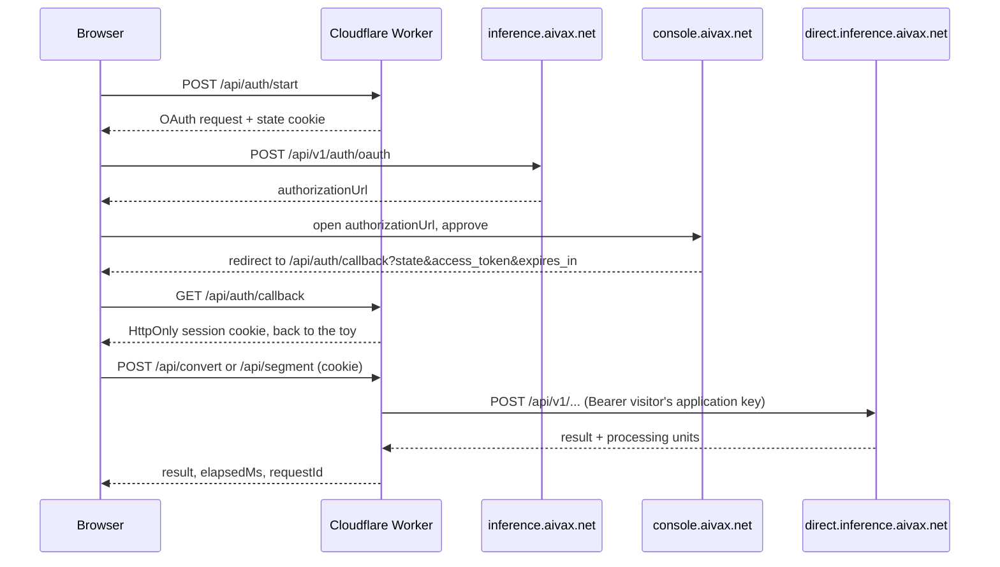

# AIVAX Toys

Small, open demos of [AIVAX](https://aivax.net) features. Each toy is a single page where you sign in with your AIVAX account and try a feature right away. It shows how long the work took and what it cost, and ships with the code that makes it work.

Live at **[toys.aivax.net](https://toys.aivax.net)**.

[](LICENSE)
[](https://developers.cloudflare.com/workers/)
[](public/)
[](https://docs.aivax.net/docs/getting-started)

## Contents

- [Toys](#-toys)
- [How it works](#-how-it-works)
- [Prerequisites](#-prerequisites)
- [Run locally](#-run-locally)
- [Environment variables](#-environment-variables)
- [API](#-api)
- [Checks](#-checks)
- [Deploy](#-deploy)
- [Adding a toy](#-adding-a-toy)
- [Troubleshooting](#-troubleshooting)
- [License](#-license)

## 🧸 Toys

| Toy | What it does | AIVAX features | Limits |
| --- | --- | --- | --- |
| [Media → Markdown](public/media-to-markdown/) | Reads a web page link, an image (PNG, JPEG, WebP, TIFF, BMP) or a PDF, including scans, into clean Markdown, then splits it into chunks ready for a knowledge base (JSONL download). | [Fetch & OCR](https://docs.aivax.net/docs/web-foundation/fetch-and-ocr), [Text segmentation](https://docs.aivax.net/docs/rag/text-segmentation) | 10 MB per file, plus your account's [AIVAX limits](https://docs.aivax.net/docs/limits) |

Every toy requires an AIVAX account. Usage is charged to the account that signed in, through an [OAuth](https://docs.aivax.net/docs/oauth) application key limited to `WebUtilities` and `InferenceGenerations`. The cost shown on each page is an estimate based on [AIVAX's public prices](https://docs.aivax.net/docs/pricing); the exact charges are in the console.

## 🧭 How it works



| Part | Path | Role |
| --- | --- | --- |
| Static site | `public/` | Vanilla HTML, CSS and JavaScript served by Workers Static Assets. No build step. |
| Worker | `src/worker.js` | Handles `/api/*`: the OAuth sign-in and callback, the session cookie, and the AIVAX calls made with the visitor's key. Returns results with latency, `x-request-id` and processing units. |
| Config | `wrangler.jsonc` | Assets binding, `run_worker_first` for `/api/*`, custom domain, and the migration that deleted the old `RateLimiter` Durable Object. |

The browser creates the OAuth request itself, because AIVAX rate limits that endpoint per remote address. The application key lives in an `HttpOnly` cookie scoped to `/api`, so page scripts never see it. There's no refresh token: when the key expires or is revoked, AIVAX returns `401` and the page asks the visitor to sign in again.

## 📋 Prerequisites

- [Bun](https://bun.sh) (or npm) to install `wrangler`.
- An AIVAX account to sign in with ([getting started](https://docs.aivax.net/docs/getting-started)). Its balance pays for what you run.
- A Cloudflare account, only for deploying.

## 🔧 Run locally

```sh
bun install
bun run dev   # http://127.0.0.1:8787
```

Sign in from the page as usual: AIVAX accepts `http://127.0.0.1:8787/api/auth/callback` as a return address. The session cookie drops `Secure` on plain `http`, so it works locally.

## 🔐 Environment variables

None. The Worker holds no AIVAX key or other secret; every call uses the key of the visitor who signed in.

## 🚀 API

The pages use these routes. Toy routes read the key from the `toys_session` cookie; with `curl` you can pass your own application or API key in it.

```sh
# Max file size and the signed-in account (null when signed out)
curl http://127.0.0.1:8787/api/config

# Sign-in: the body to send to POST https://inference.aivax.net/api/v1/auth/oauth (the page makes
# `returnUrl` absolute with its own origin), plus a state cookie
curl -X POST http://127.0.0.1:8787/api/auth/start -d '{ "next": "/media-to-markdown/" }'

# PDF or image → Markdown (multipart)
curl http://127.0.0.1:8787/api/convert \
  -b "toys_session=$AIVAX_KEY" \
  -F "file=@manual.pdf;type=application/pdf"

# Web page link → Markdown (multipart)
curl http://127.0.0.1:8787/api/convert \
  -b "toys_session=$AIVAX_KEY" \
  -F "url=https://example.com/article"

# Markdown → chunks (JSON)
curl http://127.0.0.1:8787/api/segment \
  -b "toys_session=$AIVAX_KEY" \
  -H "Content-Type: application/json" \
  -d '{ "markdown": "# Title\n\nParagraph...", "sanitize": true }'

# Sign out (clears the cookie; revoke the key itself in the console)
curl -X POST http://127.0.0.1:8787/api/auth/logout
```

`GET /api/auth/callback` is where AIVAX sends the visitor back. It checks `state`, stores `access_token` as the session cookie for `expires_in` seconds, and redirects to the page that started the sign-in.

Successful responses include `markdown` or `segments`, plus `processingUnits`, `elapsedMs` and `requestId`. Errors return `{ "error": "..." }`:

| Status | When |
| --- | --- |
| `400` | Missing file, link or Markdown; a file that isn't a PDF or supported image; or a link that isn't `http(s)://`. |
| `401` | Not signed in, or the key expired or was revoked. The session cookie is cleared. |
| `402` | The AIVAX account has no balance. |
| `403` | The key lacks a permission the route needs. |
| `413` | File over 10 MB, link over 2,048 characters, or Markdown over 400,000 characters. |
| `422` | AIVAX could not read the file or page (for example, the site blocks automated access). |
| `429` | The AIVAX account hit its rate limit. |
| `502` | AIVAX returned another error. |

For the AIVAX endpoints themselves, see the [API reference](https://inference.aivax.net/apidocs).

## ✅ Checks

```sh
bun run check   # node --check on the Worker and every page script
```

There's no automated test suite yet. To validate a change, run `bun run dev`, `curl` the affected routes (including the 400, 401 and 413 paths), and open the page at desktop and mobile widths. Every real conversion or segmentation spends the signed-in account's balance, so keep end-to-end runs short.

## 🚢 Deploy

Production runs on [Workers Builds](https://developers.cloudflare.com/workers/ci-cd/builds/): every push to `main` builds and deploys the Worker with `npx wrangler deploy`. `wrangler.jsonc` binds it to the `toys.aivax.net` custom domain.

To run your own copy:

1. Change or remove the `routes` entry in `wrangler.jsonc`, and the `clientName` and `reason` in `OAUTH_REQUEST` in `src/worker.js`.
2. Run `bun run deploy`. No secrets are needed.

The `v2` migration deletes the `RateLimiter` Durable Object that earlier versions used for per-IP limits. Keep both migration entries: Cloudflare applies only the tags it hasn't seen.

## 🧩 Adding a toy

1. Create `public/<toy>/index.html`, `public/styles/pages/<toy>.css` and `public/scripts/<toy>.js`. Reuse `styles/base.css`, `styles/components/controls.css` and `scripts/site.js`.
2. Add its routes under `/api/` in `src/worker.js`: read the key from the session cookie, call `callAivax()`, and map failures with `upstreamError()`. If it needs another AIVAX permission, add it to `OAUTH_REQUEST.permissions`; visitors must sign in again to grant it.
3. Add a card to the grid in `public/index.html`, with its icon in `styles/components/toy-art.css`.
4. Add the new script to `bun run check` and a row to the [Toys](#-toys) table.

Keep pages in English and task-first: use plain language and link the relevant docs. Keep cost to a small meter, and put API calls and code samples in the collapsed "For developers" drawer. [AGENTS.md](AGENTS.md) lists the full conventions.

## 🩺 Troubleshooting

| Symptom | Fix |
| --- | --- |
| Sign-in returns to the page still signed out | The `state` didn't match (the sign-in was started in another tab or took over an hour) or access was denied. Sign in again. |
| "Your AIVAX sign-in expired." | The key expired or was revoked in the console. Sign in again. |
| "Insufficient balance." | Add balance to the AIVAX account in the console. |
| `429` | The AIVAX account hit its plan's rate limit. Wait and try again. |
| File over 10 MB rejected | The Fetch API accepts 50 MB, but Workers cut outbound requests at about 125 s and large scans take longer. Split the PDF or shrink the image first. |
| A link returns an error | The site needs a login or blocks automated access. Use a public URL that returns the page or file itself. |

## 📄 License

Apache-2.0. See [LICENSE](LICENSE).
