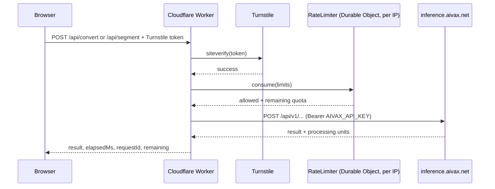

# AIVAX Toys

Small, free, open demos of [AIVAX](https://aivax.net) features. Each toy is a single page where you can try a feature right away. It shows how long the work took and what it would cost, and ships with the code that makes it work.

Live at **[toys.aivax.net](https://toys.aivax.net)**.

[](LICENSE)
[](https://developers.cloudflare.com/workers/)
[](public/)
[](https://docs.aivax.net/docs/getting-started)

## Contents

- [Toys](#-toys)
- [How it works](#-how-it-works)
- [Prerequisites](#-prerequisites)
- [Run locally](#-run-locally)
- [Environment variables](#-environment-variables)
- [API](#-api)
- [Checks](#-checks)
- [Deploy](#-deploy)
- [Adding a toy](#-adding-a-toy)
- [Troubleshooting](#-troubleshooting)
- [License](#-license)

## 🧸 Toys

| Toy | What it does | AIVAX features | Limits per visitor |
| --- | --- | --- | --- |
| [PDF → Markdown](public/pdf-to-markdown/) | Reads any PDF, including scanned pages, into clean Markdown, then splits it into chunks ready for a knowledge base (JSONL download). | [Fetch & OCR](https://docs.aivax.net/docs/web-foundation/fetch-and-ocr), [Text segmentation](https://docs.aivax.net/docs/rag/text-segmentation) | 5 documents / minute, 20 / hour, 10 MB per PDF |

Visitors are never billed. The cost shown on each page is an estimate based on [AIVAX's public prices](https://docs.aivax.net/docs/pricing).

## 🧭 How it works



| Part | Path | Role |
| --- | --- | --- |
| Static site | `public/` | Vanilla HTML, CSS and JavaScript served by Workers Static Assets. No build step. |
| Worker | `src/worker.js` | Handles `/api/*`: checks the Turnstile token, enforces the rate limit, calls AIVAX with the secret key, and returns the result with latency, `x-request-id` and processing units. |
| Rate limiter | `src/rate-limiter.js` | A SQLite-backed Durable Object per visitor IP that keeps a sliding window of document timestamps. |
| Config | `wrangler.jsonc` | Assets binding, `run_worker_first` for `/api/*`, Durable Object migration, `TURNSTILE_SITE_KEY`. |

The AIVAX API key only exists as a Worker secret. The browser never sees it.

## 📋 Prerequisites

- [Bun](https://bun.sh) (or npm) to install `wrangler`.
- An AIVAX API key ([getting started](https://docs.aivax.net/docs/getting-started)).
- A Cloudflare account, only for deploying. Local development uses Cloudflare's public Turnstile test keys.

## 🔧 Run locally

```sh
bun install
cp .dev.vars.example .dev.vars   # then set AIVAX_API_KEY
bun run dev                      # http://127.0.0.1:8787
```

`.dev.vars.example` sets Cloudflare's "always passes" Turnstile test keys, so the check succeeds locally without any setup. They override the production site key in `wrangler.jsonc`, which only works on `toys.aivax.net`.

## 🔐 Environment variables

| Name | Kind | Description | Example / default |
| --- | --- | --- | --- |
| `AIVAX_API_KEY` | Secret | AIVAX key used by the Worker for every upstream call. | `sk-aiv-...` |
| `TURNSTILE_SECRET_KEY` | Secret | Turnstile secret used for `siteverify`. | `1x0000000000000000000000000000000AA` (test) |
| `TURNSTILE_SITE_KEY` | Var (`wrangler.jsonc`) | Public Turnstile site key sent to the browser through `/api/config`. | Production widget key; `1x00000000000000000000AA` (test) in `.dev.vars` |

Locally, all three come from `.dev.vars`, which is gitignored. In production, the secrets are set once with `wrangler secret put` and survive later deploys.

## 🚀 API

The pages use these routes. You can call them yourself against `wrangler dev`; the test secret accepts any token.

```sh
# Limits, max file size, Turnstile site key and remaining quota
curl http://127.0.0.1:8787/api/config

# PDF → Markdown (multipart)
curl http://127.0.0.1:8787/api/convert \
  -F "file=@manual.pdf;type=application/pdf" \
  -F "turnstile=dummy-token"

# Markdown → chunks (JSON)
curl http://127.0.0.1:8787/api/segment \
  -H "Content-Type: application/json" \
  -d '{ "markdown": "# Title\n\nParagraph...", "sanitize": true, "turnstile": "dummy-token" }'
```

Successful responses include `markdown` or `segments`, plus `processingUnits`, `elapsedMs`, `requestId` and `remaining` (`minuteRemaining`, `hourRemaining`). Errors return `{ "error": "..." }`:

| Status | When |
| --- | --- |
| `400` | Missing file, Markdown or Turnstile token, or not a PDF. |
| `403` | Turnstile verification failed. |
| `413` | PDF over 10 MB or Markdown over 400,000 characters. |
| `422` | AIVAX could not read the PDF. |
| `429` | Rate limit reached. `Retry-After` says when to try again. |
| `500` | `AIVAX_API_KEY` is not configured. |
| `502` / `503` | AIVAX returned an error or is rate-limiting the Worker. |

For the AIVAX endpoints themselves, see the [API reference](https://inference.aivax.net/apidocs).

## ✅ Checks

```sh
bun run check   # node --check on the Worker and every page script
```

There's no automated test suite yet. To validate a change, run `bun run dev`, `curl` the affected routes (including the 400, 413 and 429 paths), and open the page at desktop and mobile widths. Every real conversion or segmentation spends AIVAX credits, so keep end-to-end runs short.

## 🚢 Deploy

Production runs on [Workers Builds](https://developers.cloudflare.com/workers/ci-cd/builds/): every push to `main` builds and deploys the Worker with `npx wrangler deploy`. `wrangler.jsonc` binds it to the `toys.aivax.net` custom domain.

To run your own copy:

1. Create a Turnstile widget at [dash.cloudflare.com → Turnstile](https://dash.cloudflare.com/?to=/:account/turnstile) for your hostname, and put its site key in `TURNSTILE_SITE_KEY` in `wrangler.jsonc`.
2. Change or remove the `routes` entry in `wrangler.jsonc`.
3. Deploy once and set the secrets:

   ```sh
   bun run deploy
   bunx wrangler secret put AIVAX_API_KEY
   bunx wrangler secret put TURNSTILE_SECRET_KEY
   ```

The first deploy applies the `RateLimiter` Durable Object migration.

## 🧩 Adding a toy

1. Create `public/<toy>/index.html`, `public/styles/pages/<toy>.css` and `public/scripts/<toy>.js`. Reuse `styles/base.css`, `styles/components/controls.css` and `scripts/site.js`.
2. Add its routes under `/api/` in `src/worker.js`, reusing `gate()` for Turnstile + rate limiting and `callAivax()` for the upstream call.
3. Add a card to the grid in `public/index.html`, with its icon in `styles/components/toy-art.css`.
4. Add the new script to `bun run check` and a row to the [Toys](#-toys) table.

Keep pages in English and task-first: use plain language and link the relevant docs. Keep cost to a small meter, and put API calls and code samples in the collapsed "For developers" drawer. [AGENTS.md](AGENTS.md) lists the full conventions.

## 🩺 Troubleshooting

| Symptom | Fix |
| --- | --- |
| "The server is missing its AIVAX_API_KEY secret." | Create `.dev.vars` from `.dev.vars.example`, or run `wrangler secret put AIVAX_API_KEY` in production. |
| "Turnstile did not load." | A content blocker is blocking `challenges.cloudflare.com`. Allow it and reload. |
| "Turnstile verification failed." | The site key and secret don't belong to the same widget, or the hostname isn't allowed on the widget. |
| `429` while testing | Wait for `Retry-After`. Limits are 5 documents per minute and 20 per hour per IP, set in `LIMITS` in `src/worker.js`. |
| PDF over 10 MB rejected | That is the AIVAX Fetch API limit per item. Split the PDF first. |

## 📄 License

Apache-2.0. See [LICENSE](LICENSE).
